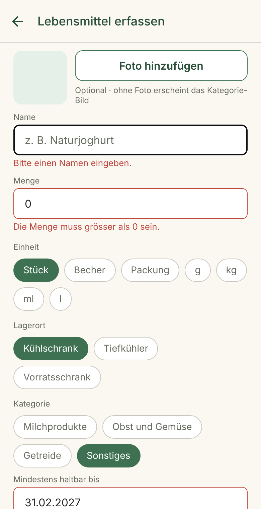

# Restlos

Restlos ist eine mobile App zur Verwaltung des eigenen Lebensmittelvorrats. Sie beantwortet die Frage: **Was sollte ich als Nächstes aufbrauchen?**

Semesterprojekt im Modul Mobile App Development (FH Graubünden, HS26). Einzelarbeit von Davide Rizzo.

## Problem und Zielgruppe

Studierende mit eigenem Haushalt kaufen regelmässig Lebensmittel ein, verlieren aber im Alltag den Überblick über den Vorrat. Produkte geraten in Vergessenheit, bis das Mindesthaltbarkeitsdatum (MHD) überschritten ist.

Die App richtet sich an Studierende in einer WG oder eigenen Wohnung, die selbstständig einkaufen und kochen und wenig Zeit für eine aufwendige Vorratsverwaltung haben.

## Funktionen

| Ansicht | Funktion |
|---|---|
| **Übersicht** | Zeigt Produkte, deren MHD überschritten ist oder in den nächsten drei Tagen liegt. |
| **Vorrat** | Alle Lebensmittel, nach MHD sortiert, mit Suche nach Namen und Filter nach Lagerort. |
| **Erfassen / Bearbeiten** | Formular mit Prüfung der Eingaben direkt am Feld und optionalem Foto aus der Galerie. |
| **Produktdetails** | Angaben zum Produkt mit den Aktionen «Aufgebraucht», «Bearbeiten» und «Löschen». |

Weitere Punkte:

- Die Daten werden mit AsyncStorage lokal auf dem Gerät gespeichert und beim Start geladen.
- «Aufgebraucht» lässt sich während acht Sekunden rückgängig machen.
- «Löschen» verlangt eine Bestätigung.
- Lade-, Fehler- und Leerzustände sind in allen Ansichten berücksichtigt.

## Screenshots

| Übersicht | Vorrat | Erfassen | Details |
|---|---|---|---|
|  |  |  |  |

## Setup

Voraussetzungen: Node.js (LTS) und die App Expo Go auf dem Smartphone oder ein iOS-/Android-Simulator.

```bash
git clone https://github.com/davide-rizzo-fhgr/Mobileapp_development.git
cd Mobileapp_development/restlos
npm install
npx expo start
```

Danach den QR-Code mit Expo Go scannen oder im Terminal `i` (iOS-Simulator) beziehungsweise `a` (Android-Emulator) drücken.

## Scripts

Alle Befehle werden im Ordner `restlos` ausgeführt.

| Befehl | Zweck |
|---|---|
| `npm start` | Startet den Expo-Entwicklungsserver. |
| `npm run ios` / `npm run android` | Startet die App direkt im Simulator beziehungsweise Emulator. |
| `npm run web` | Startet die App im Browser (nur zur Kontrolle, siehe bekannte Issues). |
| `npm run lint` | Prüft den Code mit ESLint. |
| `npx tsc --noEmit` | Prüft die Typen mit TypeScript. |

## Architektur

```text
restlos/src
├── app/                      Screens und Navigation (Expo Router)
│   ├── _layout.tsx           Stack + ProductProvider
│   ├── (tabs)/_layout.tsx    Untere Navigation
│   ├── (tabs)/index.tsx      Übersicht
│   ├── (tabs)/vorrat.tsx     Vorrat
│   ├── erfassen.tsx          Erfassen / Bearbeiten
│   └── produktdetails.tsx    Produktdetails
├── components/               Wiederverwendbare UI-Bausteine (nur Props und Callbacks)
├── context/ProductContext    Gemeinsamer State: Produkte, Ladezustand, Aktionen
├── storage/productStorage    Lesen und Schreiben mit AsyncStorage
├── utils/                    Datumsfunktionen, Sortierung, Formularprüfung
├── types/Product.ts          Datenmodell
└── constants/colors.ts       Farben
```

Datenfluss:

```text
AsyncStorage ◀──▶ productStorage ◀──▶ ProductContext ──▶ Screens ──▶ Komponenten
                  (laden/speichern)   (State, Aktionen)   ▲              │
                                                          └── Callbacks ─┘
```

- **Ein Besitzer pro State:** Der `ProductProvider` besitzt die Produktliste. Die Screens lesen und ändern sie nur über `useProducts()`. Suchtext, Filter und Formulareingaben bleiben lokaler State des jeweiligen Screens.
- **Trennung von UI und Logik:** Speichern (`storage`), Prüfen und Rechnen (`utils`) und Darstellung (`components`) liegen in getrennten Dateien.
- **Navigation:** Übersicht und Vorrat sind Tabs. Formular und Details liegen im Stack darüber und haben eine Zurück-Navigation im Header.

## Annahmen und Grenzen

- Die App funktioniert offline und speichert nur auf dem jeweiligen Gerät. Login, Cloud-Synchronisation, Barcode-Scanner und Rezeptvorschläge sind nicht Teil dieser Version.
- Das MHD dient zur Orientierung. Die App beurteilt nicht, ob ein Lebensmittel noch geniessbar ist.
- «Bald aufbrauchen» bedeutet: MHD überschritten oder in höchstens drei Tagen erreicht.
- Ein neu eingegebenes MHD darf höchstens einen Monat zurückliegen und höchstens zehn Jahre in der Zukunft liegen. Damit werden Tippfehler abgefangen. Ein bereits gespeichertes älteres MHD bleibt beim Bearbeiten gültig.
- Die Menge ist eine positive Zahl. Komma und Punkt werden als Dezimaltrennzeichen akzeptiert.
- Das Datum wird als Text im Format `TT.MM.JJJJ` eingegeben.

## Bekannte Issues

- Im Browser (`npm run web`) erscheint die Löschbestätigung nicht, weil `Alert` dort nicht unterstützt wird. Die App ist für iOS und Android gedacht.
- Sind die gespeicherten Daten beschädigt, zeigt die App eine Fehlermeldung mit «Erneut versuchen». Ein Zurücksetzen des Speichers in der App gibt es nicht. Einzelne ungültige Einträge werden beim Laden übersprungen.
- Ersetzte oder entfernte Fotos bleiben als Datei im App-Ordner liegen.
- «Rückgängig» gibt es nur für «Aufgebraucht», nicht für «Löschen».
- App-Icon und Startbildschirm sind noch die Standardbilder von Expo. Die App unterstützt nur den hellen Modus.
- Es gibt keine automatisierten Tests.

## GUI-Entwurf

Der Entwurf wurde in Figma erstellt: [Figma-Prototyp](https://www.figma.com/proto/etExXKJu7YXEuGe7R39ObV/Restlos_Figma?node-id=14-6&p=f&t=cBrfW0xAYGfpifem-1&scaling=min-zoom&content-scaling=fixed&page-id=2%3A3&starting-point-node-id=14%3A6)

Abweichungen vom Entwurf: Die Schwelle für «Bald aufbrauchen» und die Ein-Monats-Regel für das MHD sind unter «Annahmen und Grenzen» beschrieben.

## Verantwortlichkeiten und Hilfsmittel

- Konzept, Figma-Entwurf, Umsetzung und Tests: Davide Rizzo (Einzelarbeit).
- Grundlage für den Code sind die Folien und Übungen des Moduls (Todo-App, AsyncStorage, Context).
- Für Code-Review und Codevorschläge wurde ein KI-Assistent (Claude) eingesetzt.
